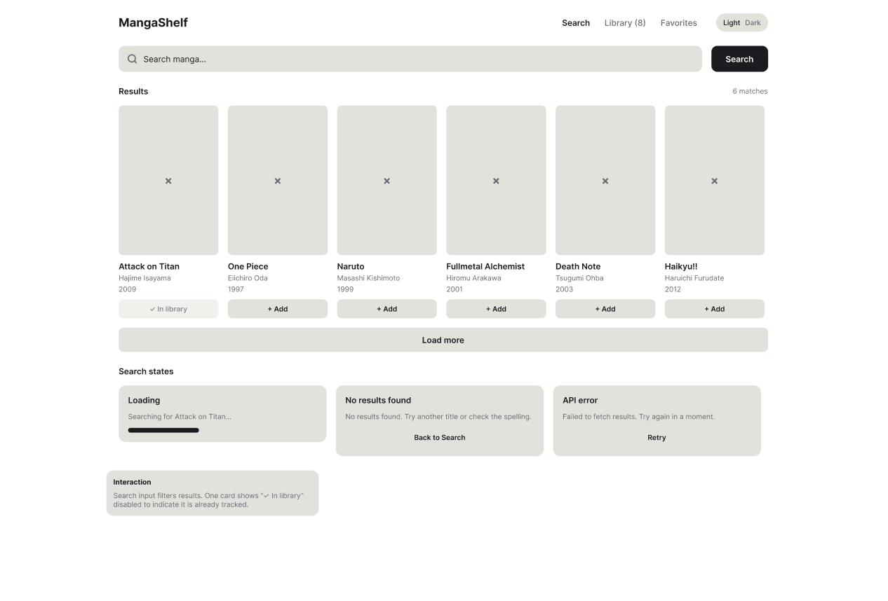
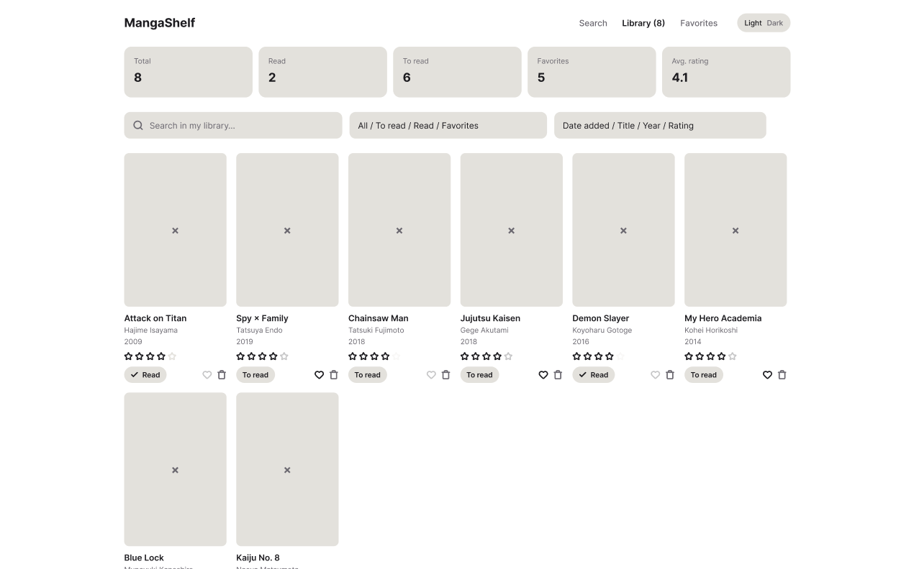
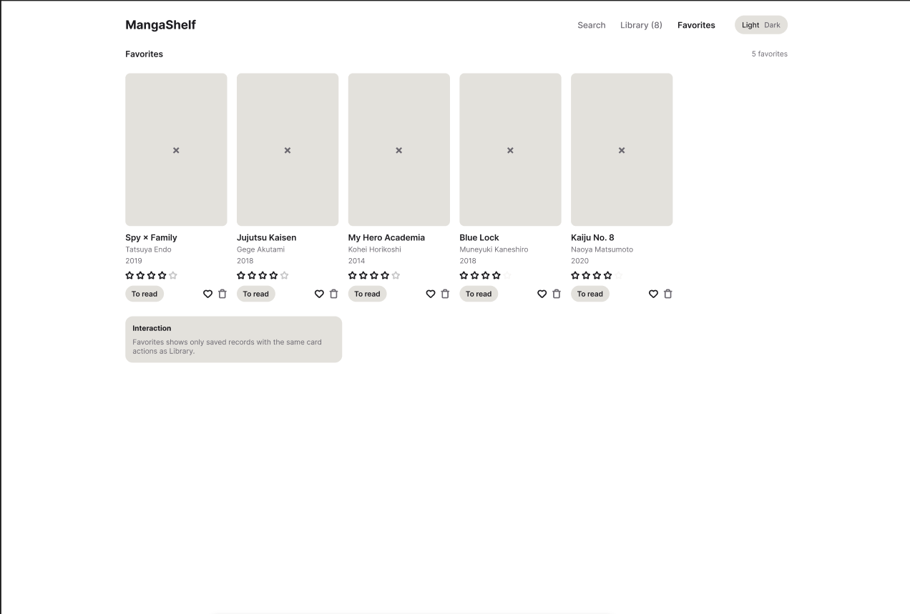
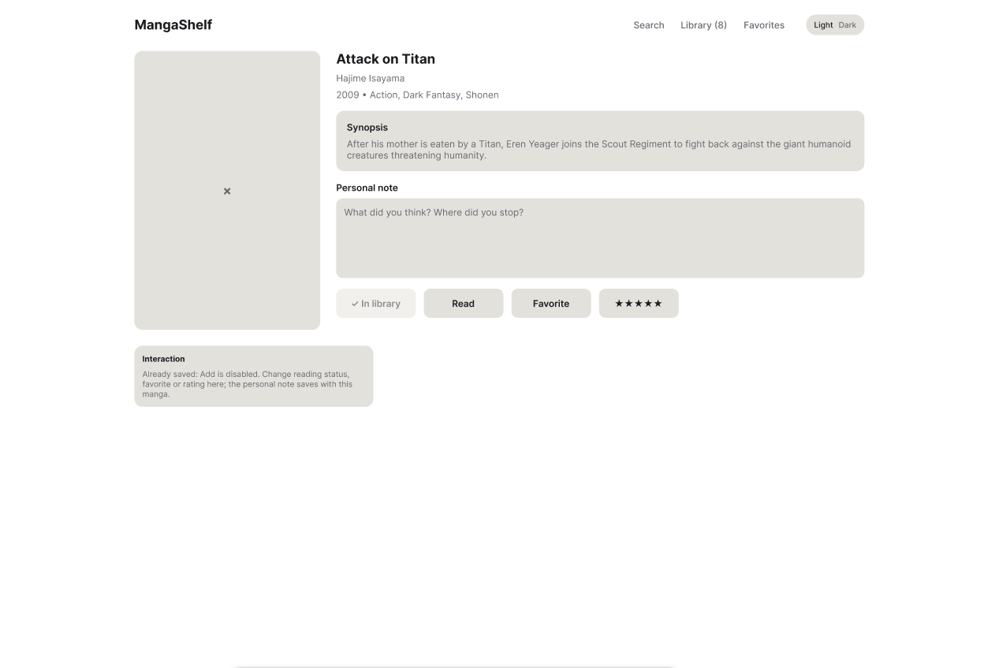

# Low-fidelity wireframes

Made in Figma: [Mangashelf Prototype](https://www.figma.com/design/v24GmVeO3An48HHtHM6oHO/Mangashelf-Prototype)

## 1. Search (`/`)

Search bar, results grid (cover, title, author, year, "+ Add" / "✓ In library"), "Load more", and the loading / no results / API error states.

## 2. Library (`/library`)

Statistics, search inside the library, status filter, sorting, and cards with rating, read status, favorite and delete.

## 3. Favorites (`/favorites`)

Only favorite manga, with the same card actions as the library.

## 4. Detail (`/manga/:id`)

Large cover, author, year, genres, synopsis, personal note, and actions (read, favorite, rating).

